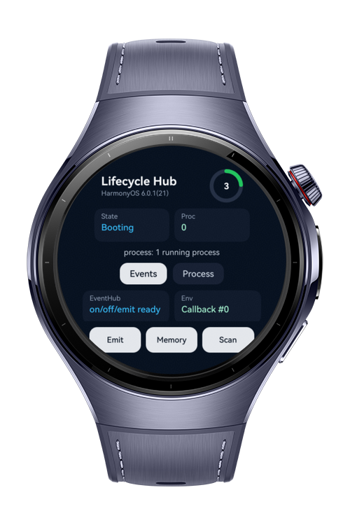
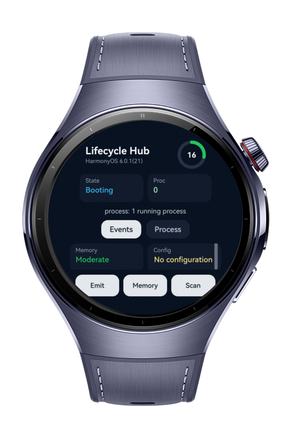
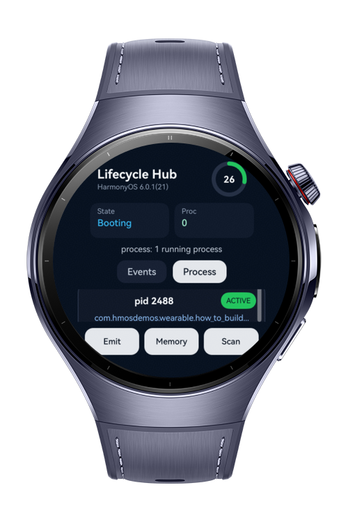

> **Note:** To access all shared projects, get information about environment setup, and view other guides, please visit [Explore-In-HMOS-Wearable Index](https://github.com/Explore-In-HMOS-Wearable/hmos-index).

# How To Build App Lifecycle Hub

This app is a wearable app lifecycle management dashboard. It shows app state, EventHub publish/subscribe flow, system environment changes, memory pressure, and running process topology in real time on a watch screen.

# Preview

<div>
  
  
  
</div>

# Use Cases

- App lifecycle state dashboard
- Intra-app event publish/subscribe with `EventHub`
- App-wide context access with `ApplicationContext`
- Configuration and memory monitoring with `EnvironmentCallback`
- Running process details with `ProcessInformation`
- Real-time memory pressure and process topology view

# Technology

## Stack

- **Languages**: ArkTS, ArkUI
- **Frameworks**: HarmonyOS SDK 6.0.1(21)
- **Tools**: DevEco Studio 6.0.1, Hvigor
- **Libraries**:
    - `@kit.ArkUI`
    - `@kit.ArkTS`
    - `@kit.AbilityKit`
    - `@kit.BasicServicesKit`

# Directory Structure

```
entry/
|   src/
|       main/
│   module.json5
│
├───ets
│   ├───entryability
│   │       EntryAbility.ets
│   │
│   ├───entrybackupability
│   │       EntryBackupAbility.ets
│   │
│   └───pages
│           Index.ets
```

# Constraints and Restrictions

## Supported Device

* Huawei Watch 5
* HarmonyOS wearable emulator

# License

**How To Build App Lifecycle Hub** is distributed under the terms of the MIT License. See the [LICENSE](LICENSE) for more information
